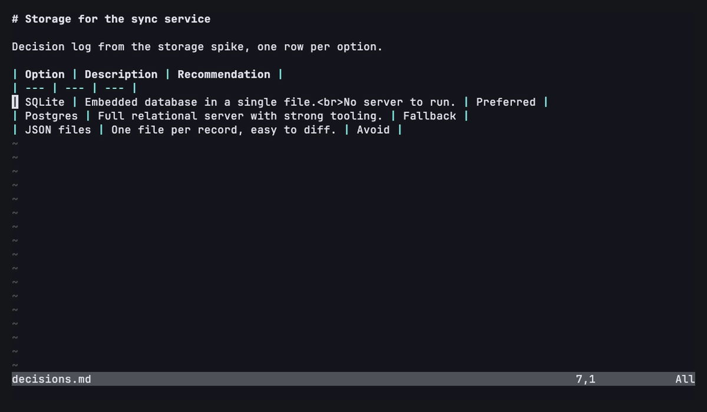

# marktable.nvim

**Edit one row of a Markdown table as plain text, in a floating window.**

Markdown pipe tables are easy to read but painful to edit once cells hold
sentences, escaped pipes, or line breaks. marktable.nvim lets you put the cursor
on a table row and open it as a small Markdown buffer with one section per
column. Edit the fields like normal text, save with `:w`, and the plugin writes
the row back into the table.



## How it works

Given this table, with the cursor on the `SQLite` row:

```markdown
| Option | Description | Recommendation |
| --- | --- | --- |
| SQLite | Embedded relational database in a single file.<br>Useful for local notes. | Preferred |
```

`:MarktableRowEdit` opens a floating editor:

```markdown
# Option
SQLite

# Description
Embedded relational database in a single file.
Useful for local notes.

# Recommendation
Preferred
```

Save it, and the plugin replaces only that row. Pipes are escaped as `\|` and
line breaks become `<br>`, so you never have to type either by hand. Nothing
else in the file changes, and no hidden markers are added.

## Installation

With [lazy.nvim](https://github.com/folke/lazy.nvim):

```lua
{ 'PreziosiRaffaele/marktable.nvim', ft = 'markdown' }
```

The plugin registers its commands on startup. Calling `setup()` is only needed
to change the defaults (see [Configuration](#configuration)).

## Commands

- `:MarktableRowNew` opens a floating editor with one empty section per table header and inserts the generated row.
- `:MarktableRowEdit` opens the data row under the cursor, shows its row number in the floating editor title, and replaces only that row.
- `:MarktableRowView` peeks at the data row under the cursor in a read-only float. Run it again to focus the view, then use `]r` / `[r` (with an optional count) to move between rows, `e` or an insert key (`i` `a` `o` `I` `A` `O`) to edit the shown row in place, and `q` or `<Esc>` to close. Saving or canceling that editor returns to the view, so you can keep moving with `]r` and editing.

Submit the editor with `:w` or `:wq`. Cancel with `q`.

No keymaps are set by default. For example, in a Markdown ftplugin:

```lua
vim.keymap.set('n', '<leader>tv', '<Cmd>MarktableRowView<CR>', { buffer = true })
```

## Configuration

Call `setup()` to override the floating window size. Defaults shown:

```lua
require('marktable').setup({
    width = 110,  -- width of the floating editor, in columns
    height = 16,  -- height of the floating editor, in rows
})
```

Both values are clamped to the available UI space, so the window never overflows the screen. The row view, and an editor opened from it, use them as maximums and fit their content, but are never narrower than 60 columns (or `width`, if smaller). The view border uses the `MarktableViewBorder` highlight group, and `MarktableViewFocusBorder` while the view has focus.

## Development

- `make quality` runs `luacheck`, `stylua --check`, and `lua-language-server`.
- `make test` runs the pinned `mini.test` suite in headless Neovim.
- `make check` runs both gates.
- The demo GIF is regenerated with `vhs docs/demo.tape`.
